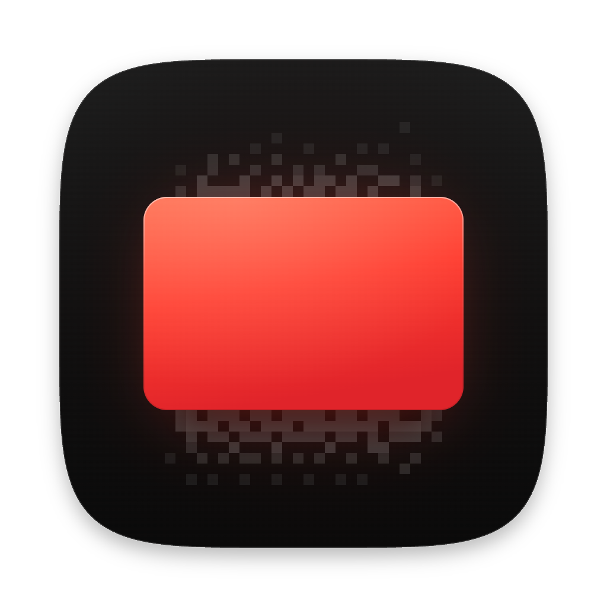
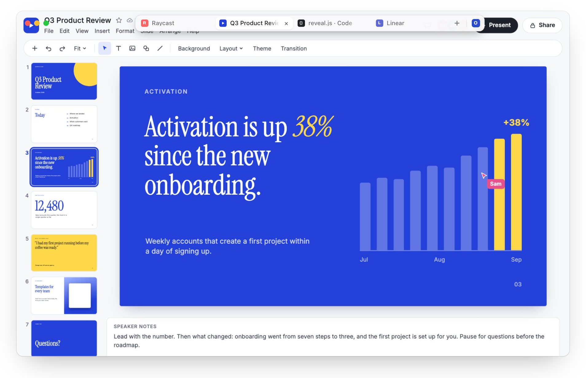

<p align="center">
  
</p>

<h1 align="center">Stage</h1>

<p align="center">
  <b>Nothing but the page.</b><br>
  A minimal Chromium browser for workshops, webinars and demos.<br>
  Share the window and your audience sees the site, edge to edge.<br>
  Your tabs wait behind the top edge until you reach for them.
</p>

<p align="center">
  <code>npx stage-browser https://example.com</code>
</p>

<p align="center">
  
</p>

## Same site. Two windows.

A normal browser spends about 100 px on tabs, the address bar and bookmarks. In a 720p share, that's **a seventh of every frame**, and every tab title, extension badge and bookmark goes out on the call with the page.

Stage gives it all back to the page. No toolbar, no address bar, no bookmarks bar. Push the pointer against the top edge and a small tab capsule slides in over the page. Move away and it's gone.

## One command.

**Zero installation.** `npx` runs Stage straight from npm: nothing to download from a website, drag into Applications or approve in System Settings.

```sh
npx stage-browser https://example.com    # run it now
npm i -g stage-browser                   # or keep the short `stage` command
```

Needs macOS and Node 18 or later. The first run downloads Stage and its Chromium, about 100 MB.

## Run of show.

**1. Before the call: open your demo tabs from the terminal.**

```sh
stage --size 1280x720 app.example.com docs.example.com
```

Each address becomes a tab. `--size` fixes the window at 16:9, so nothing reflows when you start sharing.

**2. Going live: share only the Stage window.** In Zoom, Meet or Teams, pick the Stage window instead of your whole screen. The audience gets the page and nothing around it.

**3. During the demo: reach up when you need another tab.** Push the pointer against the top edge and the tabs slide in. Or stay on the keyboard: <kbd>⌘1</kbd>–<kbd>⌘9</kbd> switch tabs and <kbd>⌘L</kbd> opens a page.

## Small on purpose.

- **Hidden tabs.** The tab capsule floats over the page and hides when you're done with it. <kbd>⇧⌘B</kbd> pins it open.
- **Extensions.** Add the ones you use from the Chrome Web Store. Their icons sit in the tab bar.
- **Terminal start.** `stage <url>` opens the page and hands your prompt back. Run it again and the page joins the open window. No app bundle to sign.
- **Share sizes.** Window presets at 1280×720, 1440×900, 1600×900 and 1920×1080. Zoom with <kbd>⌘=</kbd> and <kbd>⌘-</kbd> so the back row can read.
- **Escape hatch.** <kbd>⇧⌘O</kbd> opens the current page in Google Chrome. Zoom and Slack links open in their own apps.

## The command line

```
stage                        open Stage (restores the last session)
stage <url|domain|words> …   open each argument as a tab; bare words become a Google search
stage --size 1280x720 …      set the window's content size
stage --pin                  start with the tab bar pinned
stage --fresh                skip the saved session
stage --fg                   run in the foreground with logs in the terminal
```

If Stage is already running, `stage <url>` opens the URL as a tab in the running window.

## Hands on the keys.

| Shortcut | Action |
| --- | --- |
| <kbd>⌘T</kbd> | New tab, straight into the address box |
| <kbd>⌘L</kbd> | Go to an address or search |
| <kbd>⌘W</kbd> / <kbd>⇧⌘T</kbd> | Close a tab / reopen it |
| <kbd>⌘1</kbd> … <kbd>⌘9</kbd> | Jump to a tab (<kbd>⌘9</kbd> is the last) |
| <kbd>⌃Tab</kbd>, <kbd>⇧⌘]</kbd> / <kbd>⇧⌘[</kbd> | Next / previous tab |
| <kbd>⌘[</kbd> / <kbd>⌘]</kbd> | Back / forward |
| <kbd>⌘R</kbd> / <kbd>⇧⌘R</kbd> | Reload / hard reload |
| <kbd>⌘=</kbd> / <kbd>⌘-</kbd> / <kbd>⌘0</kbd> | Zoom in / out / reset |
| <kbd>⇧⌘B</kbd> | Pin or unpin the tab bar |
| <kbd>⌃⌘F</kbd> | Full screen |
| <kbd>⇧⌘O</kbd> | Open the page in Google Chrome |
| <kbd>⌥⌘I</kbd> | Developer tools |

In the tab bar, click the active tab to edit its address, middle-click a tab to close it, drag tabs to reorder, and right-click a tab for more.

## Extensions

Stage starts with none. Choose **Extensions → Open Chrome Web Store**, find the extension and click **Add to Chrome**. Its icon appears on the right of the tab bar, and the **Extensions** menu lists everything installed, each with a Remove option. **Hide Icons in Tab Bar** keeps the capsule bare.

Extension support comes from [electron-chrome-extensions](https://github.com/samuelmaddock/electron-browser-shell/tree/master/packages/electron-chrome-extensions), which covers most of the `chrome.*` APIs extensions rely on, but not every one. If an extension misbehaves, <kbd>⇧⌘O</kbd> opens the page in Google Chrome.

## Before you go live.

**Why does macOS ask about "Chromium Safe Storage"?**
That Keychain key decrypts your saved logins. macOS asks once after you install or update Stage. Choose **Always Allow**, or sites will treat you as signed out.

**Is it signed or notarized?**
It doesn't need to be. On first launch, Stage copies Electron's Chromium app on your own Mac, names it Stage and gives it a local signature, the same kind Electron itself ships with. That copy lives in `~/Library/Application Support/Stage/Runtime/` and takes almost no disk space.

**Where are my logins and tabs kept?**
In `~/Library/Application Support/Stage`. npx, a global install and a clone all share it, so you sign in once. Stage reopens your last tabs when it starts, and logs errors to `stage.log` in the same folder instead of interrupting you with a dialog.

**Does every extension work?**
Most do. Extensions that talk to a desktop app, such as 1Password's desktop unlock, can't connect, because Electron doesn't support Chrome's native messaging. Sign in inside the extension instead.

**Can I open more than one window?**
Not yet. Links that open new windows become tabs, and sign-in pop-ups open as small separate windows so the sign-in flow keeps working.

**Windows or Linux?**
Not yet. Stage is macOS only.

## Build from source

```sh
git clone https://github.com/andrewckor/stage-browser
cd stage-browser
npm install
npm start              # run from source
npm run cli:install    # link bin/stage.js to ~/.local/bin/stage
npm run selftest       # scripted end-to-end checks; writes selftest-out/results.json and screenshots
npm run ui:preview     # render the tab bar and address box in mock mode with headless Chrome
```

[`docs/CONTRACT.md`](docs/CONTRACT.md) describes the window layout and the interface between the main process (`src/main/`) and the overlay UI (`src/ui/`). The website lives in [`site/`](site/).

---

<p align="center">MIT · Built on Electron and Chromium</p>
